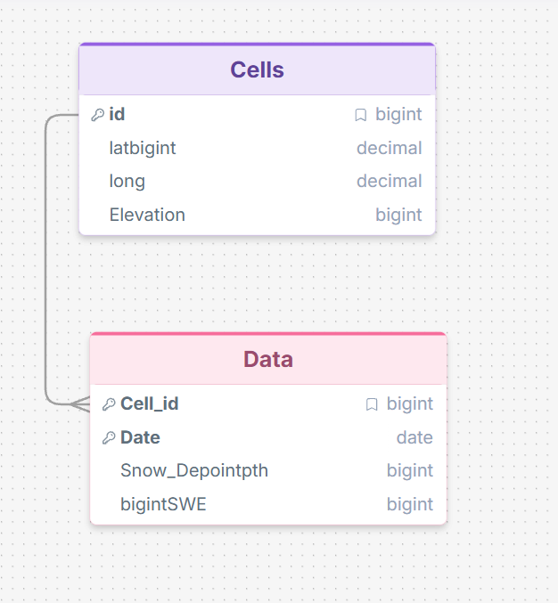
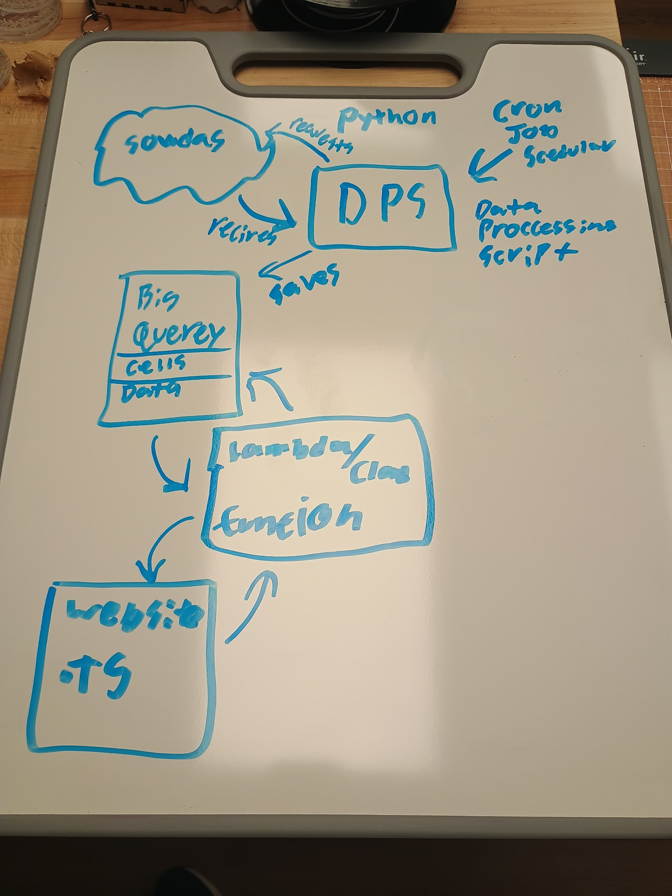

# Goal of Project
To help make data about the snow in the state of Utah more accessible and to help raise awareness of the issue of water here in the state.

#### ERD Diagram
 This is my ERD diagram for the data storage in my project. I have 2 table. (If I add SNOTEL I will have 4) The cells hold the data that wont change while data hold the days and the values that do change 
 

#### My system design diagram

This shows how my pipeline will work. I have a python data collection and processing called by a cron job. This gets the data cleans it and sends it to bigQuery. I then have a website that can use a Lambda/cloud function to get the data and display it on my site. I also have the site cash the data for the day once it is called for the first time so it wont have to keep grabbing that data.

Goals. This is hard as I need to start on this but also I have some other projects that need to be done first. 

By thanksgiving break I want to have a script that can call for the data. grab it and clean and save it to big query. 
Then I need to figure out how I will do the cron jobs
After that for the 1st week of december I want to get a basic website
Then I want to add all the functionality to my website
Then If I have time/willpower add snotel to the data and map

I don't have a ux sketch right now but I'm thinking heatmap vibes